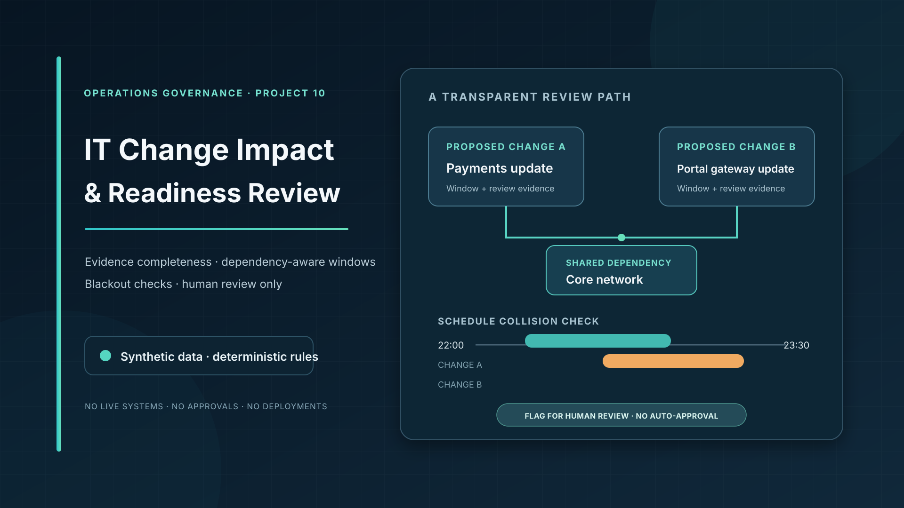

# IT Change Impact & Readiness Review



A small, offline Python proof of concept for reviewing synthetic IT change requests before they enter an organisation's normal approval process. It checks evidence completeness, known service/dependency collisions, and blackout-window intersections, then produces a reason-coded human-review queue.

> **Rules-based, synthetic data only.** This is not an ITSM platform, risk-scoring standard, approval workflow, deployment system, or compliance assessment. It never authorizes or performs a change.

## Why this project

Change Enablement includes assessing change risk and managing change schedules. This prototype explores one narrow operational task: bringing the proposed change window together with a known service/dependency snapshot so reviewers can see where evidence is missing or planned work may collide. It complements [Project #9](https://github.com/shahidalparvezmalik/it-third-party-dependency-resilience), which maps service-to-technology-provider relationships; it does not duplicate the dependency-mapping or supplier-risk work.

The design follows the portfolio's review-first approach: imported records are treated as assertions to verify, each flag has an explicit reason, and a person remains responsible for the decision.

## What it demonstrates

- Load three CSV snapshots: proposed changes, service-to-dependency links, and blackout windows.
- Flag missing owner, implementation, test, rollback, or approver evidence.
- Identify overlapping windows that affect the same service or a *confirmed* shared dependency.
- Check service- or dependency-level blackout periods.
- Surface unconfirmed or missing dependency mappings without treating them as verified.
- Write a human-review CSV, a structured JSON report, and a management summary.

## Run it

Requires Python 3.10+; no third-party packages or live connections.

```bash
python -m unittest discover -v
python -m change_readiness.cli \
  --changes data/change_requests.csv \
  --dependencies data/service_dependencies.csv \
  --blackouts data/blackout_windows.csv \
  --output-dir reports
```

The example uses only fictional records. Generated files are `reports/review.csv`, `reports/review.json`, and `reports/summary.json`.

### Observed sample run

```text
Reviewed 6 change(s); 5 change(s) flagged; every result requires human review. Reports: reports
```

The generated summary reports `HUMAN_REVIEW_ONLY`. In this fixture it counts 3 blackout conflicts, 3 overlapping windows, 1 missing-evidence case, 1 unmapped service, and 1 unconfirmed dependency. Flags can overlap on the same change.

## How to interpret the report

Every row is marked `HUMAN_REVIEW`. Flags are prompts for a responsible service/change owner to verify against authoritative records and local policy. No numeric risk score is calculated: the sample rules are not validated as a risk model. An unflagged row is not automatically safe or approved.

See [the decision rules](docs/DECISION_RULES.md), [data dictionary](docs/DATA_DICTIONARY.md), and [operating model and limits](docs/OPERATING_MODEL.md) before adapting the example.

## Boundaries

- No connection to ServiceNow, Jira, Active Directory, monitoring, CMDB, cloud, vendors, or deployment tooling.
- No real or confidential change, service, dependency, blackout, or supplier data.
- No change classification, risk score, approval recommendation, authorization, scheduling, deployment, rollback, or notification.
- Dependency records are only as reliable as the supplied snapshot. Unconfirmed links are never used to infer collisions.
- Time windows use ISO-8601 timestamps with offsets and half-open interval logic: a change ending exactly as another starts is not considered an overlap.
- This demonstration does not claim ITIL conformance or measured operational improvement.

## Research context

- [PeopleCert — ITIL 4 Practitioner: Change Enablement](https://www.peoplecert.org/browse-certifications/it-governance-and-service-management/ITIL-1/itil-4-practitioner-change-enablement-3794) describes risk assessment, authorization, and change schedules as elements of Change Enablement.
- [ServiceNow documentation — change risk assessment and conflict calendars](https://www.servicenow.com/docs/r/zurich/it-service-management/change-management/request-cm-risk-assessment.html) documents capabilities available in an established ITSM platform. This project is not a replacement for those systems.

These links provide context only; they do not validate this prototype's rules.

## Repository layout

- `change_readiness/` — review rules, CSV handling, and CLI
- `data/` — fictional change, dependency, and blackout fixtures
- `reports/` — generated sample outputs
- `tests/` — standard-library unit tests
- `docs/` — rules, field definitions, and review boundaries
- `.github/workflows/tests.yml` — test and sample-run workflow

## About

Shahid Al Parvez Malik is a Senior IT Infrastructure & Service Delivery Manager with 20+ years of professional IT experience across enterprise infrastructure, IT Operations, ITSM, service delivery, systems administration, networking, technical support, procurement and vendor management. [Portfolio](https://shahidalparvezmalik.com/) · [LinkedIn](https://www.linkedin.com/in/shahidalparvezmalik/)
